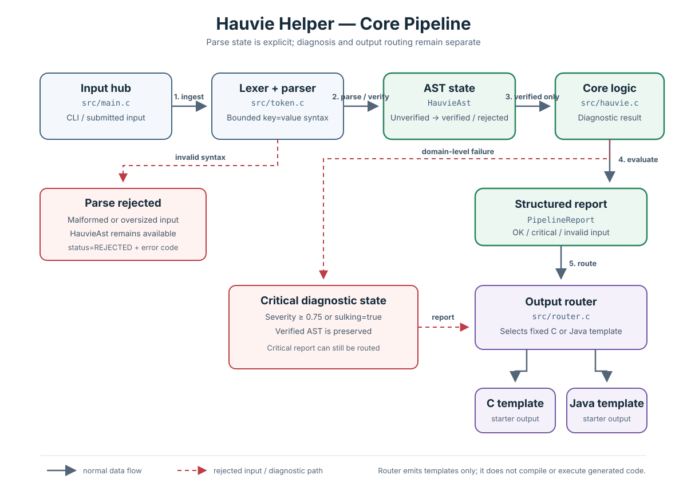

# Hauvie Helper Repair

A small C11 project that models a bounded Hauvie diagnostic pipeline and a reusable Alpha/Beta failover FSM. It remains a proof of concept: it does not provide general-purpose source-language parsing, live model integration, or hardware control. Its C and Java code-generation backends emit small starter programs from pipeline reports.

## Platform flow



```text
CLI input -> bounded token stream -> explicit AST state -> diagnostic core -> report
                                                                     |
                                                                     +-> router -> visitor-based C/Java codegen -> output sink
                                                                     |
                                                                     +-> remediation policy -> repair queue policy
```

The pipeline separates syntax and domain failures. Invalid syntax is rejected before an AST is produced. Valid but critical patients are accepted by the parser and reported as diagnostic failures; the diagnostic result does not prevent the router from selecting a C or Java output target.

## Token stream processing

`include/hauvie_token_stream.h` and `src/token_stream.c` provide a bounded, non-owning lexical stream over a NUL-terminated input string. The stream emits `WORD` and `EQUALS` tokens with source locations and explicit errors for invalid or oversized input.

Limits are explicit: source length ≤ 512 bytes, token length ≤ 64 bytes, and at most 32 emitted tokens. The `key=value` parser in `src/token.c` consumes tokens incrementally from this stream and verifies a caller-owned AST state.

## Stream-driven code generation

`include/hauvie_codegen.h` and `src/codegen.c` generate C or Java starter source from a `PipelineReport`. A backend visitor emits the document in three parts—beginning, report-specific body, and ending—through a caller-provided `HauvieCodegenSink`. The sink's write callback receives byte chunks, so output can be forwarded without assembling the whole generated document in an intermediate string.

The C and Java visitors include the diagnostic result and completed-cycle count in generated source. C output also returns a success or failure status based on the pipeline result; Java output prints a readiness message. Unsupported targets, invalid arguments, and a sink write failure cause generation to return `false`. This is a small template generator, not a C/Java parser, compiler, or general-purpose source generator.

## Router output

`include/hauvie_router.h` and `src/router.c` provide router APIs for generating the C or Java starter source:

- `hauvie_router_render(FILE *, ...)` writes directly to a `FILE` stream.
- `hauvie_router_render_buffer()` writes into caller-owned storage and supports a sizing call with `buffer == NULL` and `capacity == 0`.
- `required` reports the number of generated bytes, excluding the NUL terminator; `written` reports bytes stored.
- An undersized nonzero buffer receives a safely truncated, NUL-terminated prefix. Use at least `required + 1` bytes for the complete output.
- Invalid arguments, unsupported targets, and generation errors return failure and reset the supplied length outputs to zero.

The router adapts the visitor-based generator to these output destinations; generated templates remain intentionally small and fixed in structure.

## Diagnostic remediation policy

`include/hauvie_remediation.h` and `src/remediation.c` keep policy separate from diagnosis and execution:

| Pipeline result | Remediation |
| --- | --- |
| `PIPELINE_OK` | `HAUVIE_REMEDIATION_NONE` |
| `PIPELINE_CRITICAL_HAUVIES` | `HAUVIE_REMEDIATION_REVIEW` |
| `PIPELINE_INVALID_ARGUMENT` | `HAUVIE_REMEDIATION_UNSPECIFIED` |
| `PIPELINE_INFRASTRUCTURE_FAILURE` | `HAUVIE_REMEDIATION_UNSPECIFIED` |

An unspecified policy does not imply an action, including for unknown future values. The existing repair queue interprets critical patient diagnostics by creating a bounded `action=review` request; it does not execute remediation itself. Provider callbacks remain responsible for external work.

See [Diagnostic remediation and bounded router output](docs/remediation.md), [Pipeline architecture](docs/pipeline.md), and [Repair queue integration](docs/repair-queue.md).

## Reusable Alpha/Beta failover FSM

Public interface: `fsm/include/hauvie_fsm.h`; implementation: `fsm/src/hauvie_fsm.c`. It is an event-driven state machine only; it creates no threads, event loop, timers, or provider requests. The caller handles returned actions and supplies completion and timeout events. Stale provider/request IDs are ignored.

## Async provider runtime

`fsm/include/hauvie_runtime.h` and `fsm/src/hauvie_runtime.c` provide an event-loop-agnostic asynchronous adapter for the FSM. A caller supplies submit/cancel callbacks and delivers completion or timeout events to the runtime. Provider requests receive monotonically increasing IDs, Alpha failures fall back to Beta, and stale events are ignored.

The owner must keep request payloads alive and unchanged through the terminal callback. Payloads are capped at 512 bytes. Calls must be serialized on one event-loop thread; callbacks must be bounded and nonblocking and must not re-enter the runtime.

See [docs/runtime-api.md](docs/runtime-api.md) for payload validation, callback semantics, cancellation, timeout, and lifetime policies.

## Build and test

Requires a C11 compiler and Make:

```sh
make
make test
```

The focused router/remediation tests run with:

```sh
make test-router-remediation
./test-router-remediation
```

Tests cover core diagnostics, AST state, token boundaries and parser integration, FSM transitions, asynchronous runtime behavior, and repair-queue integration.

## Current limitations

The project does not parse C or Java source, integrate a live model, or control hardware. Code generation currently emits small visitor-driven C and Java starter templates from a pipeline report; it is not a general-purpose generator or compiler. Remediation is an explicit policy lookup rather than an execution engine. The failover runtime remains the caller's responsibility, including its event loop and provider callbacks.
