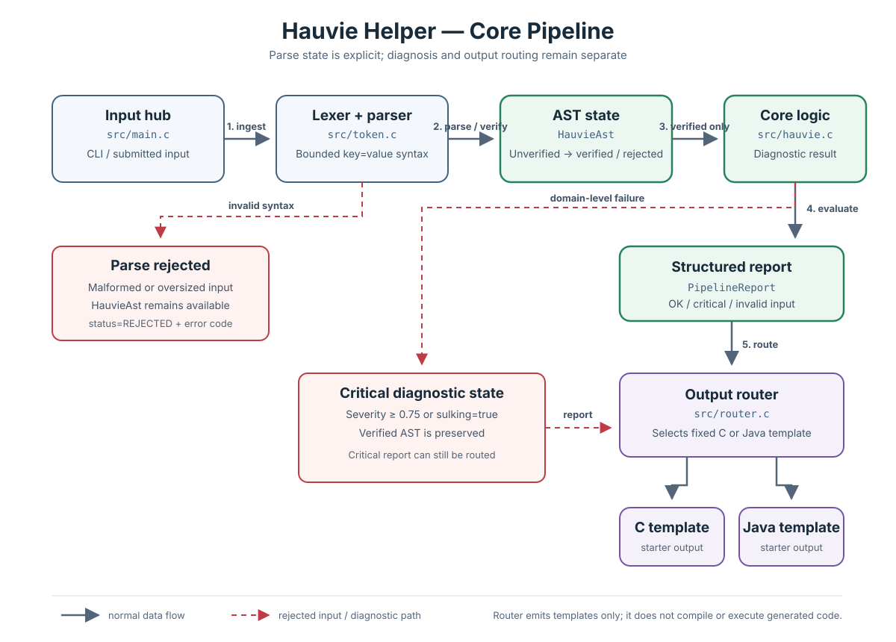

# Hauvie Helper Repair

A small C11 project that models a bounded Hauvie diagnostic pipeline and a reusable Alpha/Beta failover FSM. It remains a proof of concept: no general-purpose source-language parsing, production code generation, live model integration, or hardware control is implemented.

## Token stream processing (first draft)

`include/hauvie_token_stream.h` and `src/token_stream.c` provide a bounded, non-owning lexical stream over a NUL-terminated input string. The stream emits `WORD` and `EQUALS` tokens, with source locations and explicit errors for invalid or oversized input.

Limits are explicit: source length ≤ 512 bytes, token length ≤ 64 bytes, and at most 32 emitted tokens. The `key=value` parser in `src/token.c` consumes tokens incrementally from this stream and verifies a caller-owned AST state.

Example token sequence for `patient=alpha severity=0.3`:

```text
WORD("patient") EQUALS WORD("alpha") WORD("severity") EQUALS WORD("0.3") END
```

## Pipeline overview



```text
CLI input -> bounded token stream -> explicit AST state -> diagnostic core -> report -> C/Java starter template
```

The AST state is caller-owned and explicit: it is initialized as `UNVERIFIED`, then becomes `VERIFIED` or `REJECTED` with an error. Syntax validity is distinct from domain severity; a valid critical patient is accepted by the parser but reported as a diagnostic failure.

## Input and diagnostic behavior

The CLI accepts:

```sh
./hauvie-helper [patient-id [severity]]
./hauvie-helper --source 'patient=Tech-Agent-404 severity=0.2 sulking=false target=c'
```

The source DSL supports unique, whitespace-separated `patient`, `severity`, `sulking`, and `target` fields. Defaults are patient `Tech-Agent-404`, severity `0.2`, `false`, and `c`. Severity must be finite and between 0 and 1 inclusive; severity ≥ 0.75 or `sulking=true` produces a critical diagnostic.

`src/hauvie.c` currently validates and reports status; its three-cycle success loop is a placeholder, not actual extrusion. `src/router.c` emits fixed C/Java starter templates and does not compile them.

## Reusable Alpha/Beta failover FSM

Public interface: `fsm/include/hauvie_fsm.h`; implementation: `fsm/src/hauvie_fsm.c`. It is an event-driven state machine only; it creates no threads, event loop, timers, or provider requests. The caller handles returned actions and supplies completion and timeout events. Stale provider/request IDs are ignored.

## Async provider runtime

`fsm/include/hauvie_runtime.h` and `fsm/src/hauvie_runtime.c` provide an event-loop-agnostic adapter for the FSM. A caller supplies asynchronous submit/cancel callbacks and delivers completion or timeout events to the runtime. Provider requests receive monotonically increasing IDs, Alpha failures fall back to Beta, and stale events are ignored. The request payload is borrowed and is limited to 512 bytes. The owner must keep it alive and unchanged through the terminal callback. Calls must be serialized on one event-loop thread; callbacks must be bounded and nonblocking and must not re-enter the runtime. See [`docs/runtime-api.md`](docs/runtime-api.md) for payload validation, callback semantics, cancellation, timeout, and lifetime policies. No threads, timers, network clients, or live model providers are bundled.

## Build and tests

Requires a C11 compiler and Make:

```sh
make
make test
```

Tests cover core diagnostics, AST state, token stream boundaries and parser integration, FSM transitions, and the async runtime's success, failover, timeout, cancellation, stale-response behavior, and payload-size validation.

## Current limitations

No stream-driven code generation, bounded output-buffer writer, C/Java source parsing, actual extrusion/remediation rules, live model integration, timer/event-loop implementation, or hardware control has been implemented.
