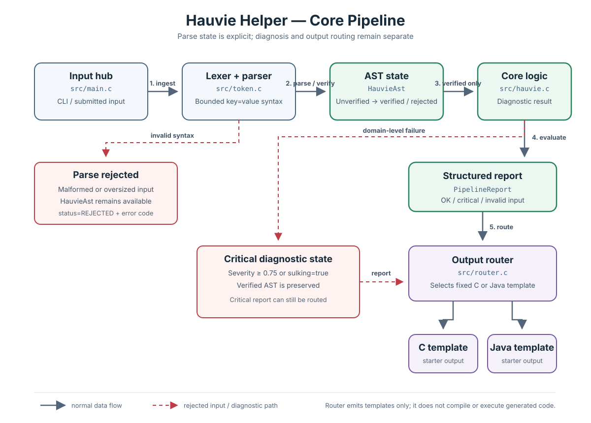

# Pipeline diagram

The diagram separates syntax/token failures from domain-level diagnostic failures. Invalid syntax is rejected before an AST is produced. High severity or sulking remains valid input, produces a structured critical report, and does not prevent the output router from selecting a C or Java starter template.

The SVG is self-contained and can be viewed in a browser or embedded in documentation tools that support SVG images.
